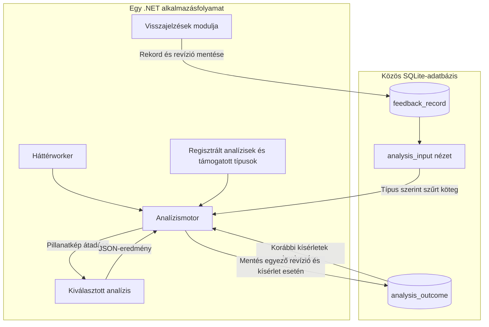

# Analízismotor moduláris monolitban

[English](README.md) · Magyar

Futtatható C#-váz adatbázisrekordok aktuális változatának elemzéséhez. Egy .NET 10 háttérworker időközönként lekérdezi az SQLite-adatbázist, lefuttatja a rekord típusához regisztrált analíziseket, majd ugyanabba az adatbázisba menti az eredményeket. Minden modul egy folyamatban fut.

| Rekordtípus | Szószámlálás | Alacsony pontszám (1–2 az 5-ből) |
|---|:---:|:---:|
| Ügyfélértékelés | ✓ | ✓ |
| Hibajegy | ✓ | — |

## Kipróbálás

A futtatáshoz .NET 10 SDK szükséges. A tároló gyökerében, üres adatbázissal indulva add ki a következő parancsokat.

```sh
dotnet run -- seed
dotnet run -- once
dotnet run -- results
dotnet run -- once
```

Az első kör **3** eredményt ment. Mindkét mintaszöveg három szóból áll, az R1 értékelés pedig alacsony pontszámot kapott. A második kör **0** eredményt ment. A `results` az aktuális eredményeket soronként egy JSON-objektumként adja vissza.

Az egyik terminálban indítsd el a folyamatos feldolgozást.

```sh
dotnet run -- worker
```

Egy második terminálban ugyanebből a könyvtárból módosítsd az R1 értékelést. A következő lekérdezési kör után a revízió 2, a szószám 2, az alacsony pontszám jelzője pedig hamis lesz.

```sh
dotnet run -- put R1 review '{"text":"Fast response","rating":5}'
dotnet run -- results
```

A worker Ctrl+C-vel állítható le. Az adatbázisfájlt az `ANALYSIS_DB` környezeti változóval adhatod meg (alapérték `analysis.db`). A körök utáni várakozást az `ANALYSIS_INTERVAL_SECONDS` állítja másodpercben (alapérték 5, tartomány 1–86400).

## Architektúra



A visszajelzések modulja kezeli a forrástáblát. Egy olvasási nézeten keresztül stabil azonosítót, típust, revíziót és JSON-adatot ad át. Az eredménytábla az analízismodulhoz tartozik. [FeedbackRecords.cs](FeedbackRecords.cs) · [AnalysisStore.cs](AnalysisStore.cs)

A motor körönként és analízisenként legfeljebb 100 esedékes rekordot olvas. A számítás az írási tranzakción kívül fut. Mentéskor a motor ellenőrzi a forrásrevíziót és a kísérlet sorszámát. Az egyedi kulcs négy eleme a rekordazonosító, a forrásrevízió, az analízis kulcsa és az algoritmus verziója. Újraindítás után a worker a mentett állapotból folytatja. Hiba után 5, majd 10 másodperc elteltével, a következő esedékes körben próbálkozik újra. A harmadik sikertelen kísérlet hibája a `results` kimenetében marad. A többi rekord és analízis feldolgozása folytatódik. [Engine.cs](Engine.cs) · [AnalysisWorker.cs](AnalysisWorker.cs)

## Új analízis hozzáadása

Valósítsd meg az `IAnalysis` interfészt, add meg a támogatott rekordtípusokat, majd regisztráld az osztályt a többi szabály mellett a `Program.cs` fájlban. Az alábbi példa az üres szövegű hibajegyeket jelzi. [AnalysisRules.cs](AnalysisRules.cs) · [Program.cs](Program.cs)

```csharp
internal sealed class EmptyTicket : IAnalysis
{
    public string Key => "empty_ticket";
    public int Version => 1;
    public IReadOnlyList<string> Kinds { get; } = ["ticket"];

    public JsonElement Run(JsonElement input) =>
        JsonSerializer.SerializeToElement(new
        {
            empty = string.IsNullOrWhiteSpace(input.GetProperty("text").GetString())
        });
}
```

```csharp
builder.Services.AddSingleton<IAnalysis, EmptyTicket>();
```

Használd a többi szabálynál látható névteret és importokat. Újraindítás után a worker a már létező hibajegyeket is feldolgozza. Ha változik a számítás jelentése, növeld a szabály verzióját az újraszámításhoz. Új bemeneti típushoz tedd elérhetővé annak adatait a nézetben, és vedd fel a típust az alkalmazható szabályokhoz.

## Feldolgozási tulajdonságok és korlátok

- A worker a legfrissebb revíziót látja. Két lekérdezés közötti módosítások összevonódhatnak. Minden egyes változat feldolgozásához a forrás mentésével együtt írt, tartós változásnapló szükséges.
- A forrásazonosító stabil, és egy másik rekordhoz később sem használható fel. Minden releváns változásnak növelnie kell a revíziót. A példa mentéskor a típust és a szerializált JSON-adatot hasonlítja össze.
- Az eredmény kis késéssel követi a forrást. Az aktuális eredmények között az adott forrásrevízióhoz és aktív szabályverzióhoz tartozó mentések jelennek meg. A korábbi eredmények megmaradnak a táblában.
- Kiindulásként egy worker fut. Párhuzamos workerek kétszer is kiszámíthatják ugyanazt, ezért az analízisek legyenek determinisztikusak és mellékhatásmentesek. A feltételes mentés megvédi az elfogadott eredményt az elavult visszaírástól.
- A kötegméret a számítások mennyiségét korlátozza. Az esedékes feladatok keresése nagy állománynál sok sort érinthet. Ha a mérés szerint ez viszi el az időt, a forrásmódosítással egy tranzakcióban írt feladatsor válthatja ki a keresést.
