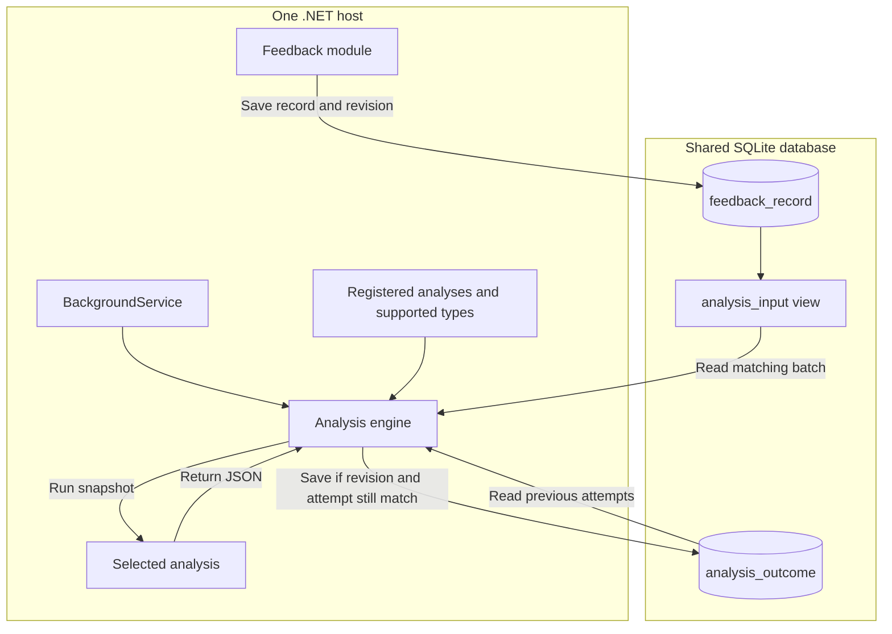

# Modular monolith analysis engine

English · [Magyar](README.hu.md)

A runnable C# skeleton for analyzing the latest version of a database record. A .NET 10 hosted worker polls SQLite, runs the analyses registered for each record type, and persists each outcome in the same database. All modules run in one process.

| Record type | Word count | Low rating (1–2 out of 5) |
|---|:---:|:---:|
| Customer review | ✓ | ✓ |
| Support ticket | ✓ | — |

## Run the example

Install the .NET 10 SDK. From the repository root, run the following commands against a fresh database.

```sh
dotnet run -- seed
dotnet run -- once
dotnet run -- results
dotnet run -- once
```

The first pass writes **3** outcomes. Both sample texts have three words, and review R1 has a low rating. The second pass writes **0**. Each line from `results` is a JSON object for a current outcome.

Start the background worker in one terminal.

```sh
dotnet run -- worker
```

In a second terminal in the same directory, update R1. After the next poll, its revision is 2, its word count is 2, and its low-rating flag is false.

```sh
dotnet run -- put R1 review '{"text":"Fast response","rating":5}'
dotnet run -- results
```

Ctrl+C stops the worker. Set `ANALYSIS_DB` to choose a database file (default `analysis.db`). Set `ANALYSIS_INTERVAL_SECONDS` to choose the delay after each pass (default 5, range 1–86400).

## Architecture



The feedback module owns its table and publishes a read view with a stable ID, type, revision and JSON payload. The analysis module owns the outcome table. [FeedbackRecords.cs](FeedbackRecords.cs) · [AnalysisStore.cs](AnalysisStore.cs)

Each pass reads up to 100 eligible inputs per analysis. Rules compute outside the write transaction. A conditional write verifies the input revision and attempt number, then stores the result under a unique key of record ID, source revision, analysis key and algorithm version. Restarting resumes from persisted state. A failed rule is retried after 5 and 10 seconds at the next eligible poll. After three failed attempts its error remains available in `results`. Other records and analyses can still complete. [Engine.cs](Engine.cs) · [AnalysisWorker.cs](AnalysisWorker.cs)

## Add an analysis

Implement `IAnalysis`, declare the supported types, and register the implementation next to the other rules in `Program.cs`. For example, this rule flags tickets with an empty text field. [AnalysisRules.cs](AnalysisRules.cs) · [Program.cs](Program.cs)

```csharp
internal sealed class EmptyTicket : IAnalysis
{
    public string Key => "empty_ticket";
    public int Version => 1;
    public IReadOnlyList<string> Kinds { get; } = ["ticket"];

    public JsonElement Run(JsonElement input) =>
        JsonSerializer.SerializeToElement(new
        {
            empty = string.IsNullOrWhiteSpace(input.GetProperty("text").GetString())
        });
}
```

```csharp
builder.Services.AddSingleton<IAnalysis, EmptyTicket>();
```

Use the namespace and imports from the other rules. On restart, the worker picks up existing tickets. Increase the rule version when its meaning changes to recompute its results. To support a new input type, publish it through the input view and add the type to each applicable rule.

## Processing guarantees and limits

- Polling observes the latest revision. Edits between two polls may collapse into one calculation. Processing every edit requires a durable change log written alongside the source change.
- A source ID must be stable and never reused. Every relevant source change must advance the revision. The sample compares the type and serialized JSON when saving.
- Results are eventually consistent. The current-results query exposes an outcome only for the current input revision and active rule version. Older outcomes remain in the table.
- Start with a single worker. Concurrent workers can calculate the same input, so keep rules deterministic and free of side effects. The conditional write prevents a stale calculation from replacing an accepted outcome.
- The batch size limits computation. Finding pending work may still scan many records. A transactional work queue is a natural next step when profiling shows that polling dominates.
